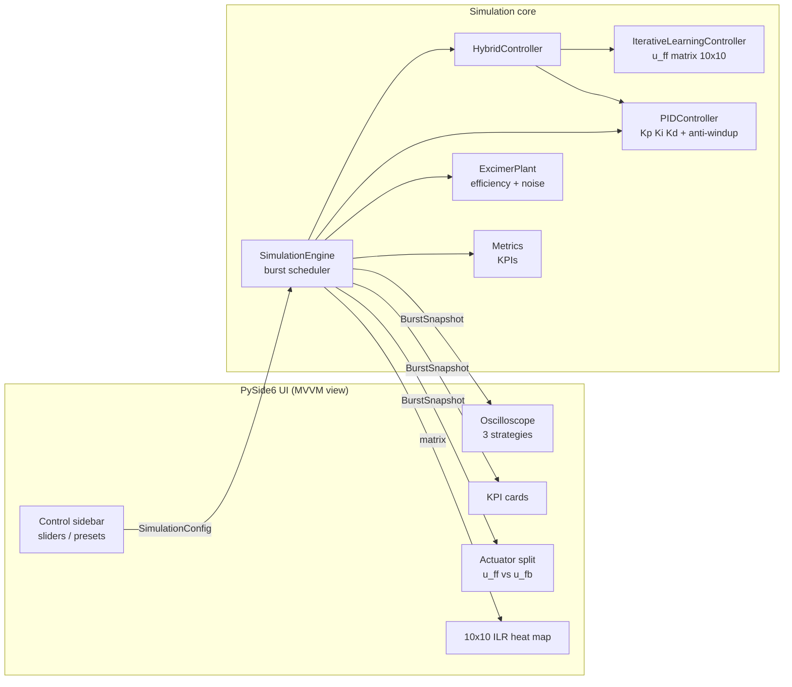

# Excimer Burst Energy Control

Interactive, real-time simulation of **pulse-to-pulse energy control** for an excimer
laser running in **2 kHz burst mode**. The application puts three control strategies
side by side on the same plant and the same noise realisation, so the difference is
visible pulse by pulse rather than argued about in a slide deck.

| Strategy | Idea | Expected behaviour |
|---|---|---|
| **HV constant** (open loop) | One charging voltage for the whole burst | Energy decays with the gas state (≈20 % droop) |
| **PID only** (feedback) | Closed loop on the energy monitor | Lags and overshoots at the burst-start transient, limited by Timelog dead time |
| **Hybrid ILR + PID** | Learned per-pulse feedforward table + PID trimming the residual | Converges burst over burst; the PID share decays towards zero |

The project is a portfolio piece for a control-engineering / software-architecture
interview: the emphasis is on a physically defensible model, clean layering
(core ⇄ UI), typed code and tests that prove the control claims numerically.

---

## 1. Industrial context

An excimer laser (ArF/KrF, 193/248 nm) used for lithography or annealing fires
**bursts of a few hundred pulses at 2–6 kHz**. Two effects make constant-voltage
operation unusable:

1. **Gas degradation** — each discharge changes the gas chemistry, so the energy per
   pulse falls monotonically during the burst (here ≈0.4 % per pulse).
2. **Burst-start transient** — after a pause the first pulses are weaker until the
   gas state re-establishes (here a 15 % dip with a 3-pulse time constant).

The energy monitor ("Timelog") reports the pulse energy only **after** the pulse,
which introduces a dead time of 1–3 pulses in every feedback loop. That dead time is
what makes a plain PID struggle at the burst start.

**Iterative Learning Control (ILC/ILR)** exploits the fact that the disturbance is
*repetitive*: it is nearly identical in every burst. So instead of fighting it after
the fact, the controller learns a per-pulse feedforward command table from burst to
burst and only uses feedback for the non-repetitive remainder (noise, drift).

---

## 2. Architecture



**Layering rule:** `src/core` never imports Qt. Every control decision is testable
headless; the UI is a pure projection of `BurstSnapshot` objects.

```
src/
├── core/
│   ├── config.py        # frozen dataclasses, presets, validation
│   ├── plant.py         # gain medium: efficiency profile + noise
│   ├── controllers.py   # PID, ILR, hybrid
│   ├── filters.py       # Q-filter (moving average)
│   ├── metrics.py       # max deviation, σ, RMS, settling time
│   └── simulation.py    # engine, BurstSnapshot, mode registry
└── ui/
    ├── theme.py         # industrial dark theme
    ├── main_window.py   # wiring, timer, CSV export
    └── widgets/         # oscilloscope, KPI cards, actuator split, heat map, sidebar
```

---

## 3. Control model

### 3.1 Plant

The actuator coordinate `u` is expressed in **mJ-equivalent** units around the
operating point (linearised HV → energy characteristic), so the plant is

$$
E[i] = u[i] \cdot \eta(i) \cdot (1 + n[i]),
\qquad
\eta(i) = e^{-\beta i}\left(1 - d\,e^{-i/\tau}\right)
$$

with decay rate `β`, transient depth `d`, transient time constant `τ` and relative
pulse noise `n ~ N(0, σ)`. All three strategies see the **same** `n[i]` sequence, so
the comparison is paired and not noise-limited.

### 3.2 PID

$$
u_{fb}[k] = K_p e[k] + K_i \sum_{j\le k} e[j] + K_d \left(e[k]-e[k-1]\right),
\qquad e[k] = E_{target} - E_{meas}[k-L]
$$

with integral clamping (anti-windup) and an output limit. `L` is the Timelog dead
time; for the first `L` pulses the last known energy (the target) is used.

### 3.3 Iterative Learning Control

The feedforward matrix holds one command per pulse of the burst, laid out as a
**10 × 10 grid** (100 pulses). After each burst:

$$
u_{ff,k+1} = Q\!\left(u_{ff,k} + \alpha \, e_k\right),
\qquad
Q(x)[i] = \frac{1}{q}\sum_{j=-\lfloor q/2\rfloor}^{\lceil q/2\rceil - 1} x[i+j]
$$

`α` is the learning factor, `Q` the Q-filter (centred moving average of depth `q`)
that keeps pulse noise out of the learned table. Because the disturbance is
repetitive, the recursion converges towards the inverse efficiency profile:

$$
u_{ff,\infty}[i] \approx \frac{E_{target}}{\eta(i)}
$$

The hybrid command is `u = u_ff[i] + u_fb[k]`, so as the table converges the PID term
shrinks to the noise floor — visible live in the actuator panel. To make that split
physically meaningful the hybrid's integrator is reset at every burst boundary: the
repetitive part belongs to the learner, and a cross-burst integral would otherwise
silently carry a constant offset that the table can never absorb.

**Why `Q` filters the whole update, not just the error.** The PID acts *inside* the
burst through the Timelog dead time, so the map from the table to the energy is not
the plant alone but the lifted closed loop `G` (`src/core/stability.py`). Version 1.0
used `u + α·Q(e)`; its error propagation `I − αQG` has a spectral radius of 1.10
(standard) to 1.26 (3-pulse latency). The divergence is invisible over the first 15
bursts and reaches 177 % max deviation after 200. The robust form `Q(u + αe)` is a
2-norm contraction, `‖Q(I − αG)‖₂ ≈ 0.92 < 1`, in every preset, so it converges
monotonically. The price is a bounded bias where the table cannot follow the sharp
start transient: −2.2 % on pulse 0, below 0.5 % on every other pulse (ADR 0004,
`tests/test_stability.py`).

With pulse noise the table fluctuates around the fixed point because every update
injects `α · σ`; the Q-filter on the full update also low-passes that injection, and
the hybrid stays inside 0.08 mJ RMS for 200 bursts.

### 3.4 KPIs

| KPI | Definition |
|---|---|
| Max deviation | `max |E - E_target| / E_target` in % |
| σ | Standard deviation of the energy error in mJ |
| RMS | `sqrt(mean((E - E_target)²))` in mJ |
| Settling | First pulse after which a **5-pulse moving average** of the error stays inside ±2 % |

Settling is judged on a smoothed error because a raw threshold would be dominated by
the 1 % pulse noise.

---

## 4. What the demo shows

| Burst | Open loop | PID only | Hybrid |
|---|---|---|---|
| 0 | 21.5 % max dev | 9.2 % | 9.2 % (identical start) |
| 5 | 22.2 % | 19.6 % | 6.1 % |
| 14 | 21.8 % | 18.2 % | **3.8 %**, RMS 0.052 mJ |
| 199 | 20.5 % | 19.4 % | **3.5 %**, RMS 0.046 mJ |

Measured with the default preset (100 pulses, 2-pulse dead time, α = 0.6, q = 3).
Mean |u_fb| drops from 0.28 mJ-eq (burst 0) to 0.03 (bursts 10–14). The PID keeps
re-fighting the same transient every burst; the learned table does not forget, and
since 2.0 it also does not drift.

---

## 5. Installation & run

```bash
python -m venv .venv
source .venv/bin/activate          # Windows: .venv\Scripts\activate
pip install -r requirements.txt
python main.py
```

Tested with Python 3.11/3.12, PySide6 ≥ 6.6, pyqtgraph ≥ 0.13, numpy ≥ 1.26.

### Controls

| Input | Action |
|---|---|
| `Space` | Play / pause the burst clock (25 bursts/s) |
| `→` | Advance one burst |
| `Ctrl+R` | Reset the simulation |
| Sliders | Target energy, gas decay, noise, Timelog latency, PID gains, α, Q-depth |
| `Export CSV` | Writes the current burst (all three modes) and the 10 × 10 matrix |

### Presets

* **Standard 2 kHz** — nominal process.
* **Strong gas noise** — 4 % pulse noise, faster decay: the PID visibly drowns, the
  Q-filter earns its keep.
* **High latency (3 pulses)** — dead time at the spec limit: the PID rings, the
  learned feedforward still holds the burst (indefinitely since the 2.0 learning
  law; 1.0 diverged here after ~12 bursts). Push `Kp` above ≈1.0 here to drive the
  loop into visible instability — that is the honest limit of feedback with dead time.

---

## 6. Tests

```bash
pip install -r requirements-dev.txt
python -m pytest -q
python -m ruff check src tests main.py
```

The suite covers, among others:

* monotonic convergence of the ILR matrix over bursts
* convergence of the learned profile to `E_target / η(i)` within 1 % (2.5 % on pulse 0)
* lifted-system proof that the learning law is a contraction for every preset, and
  200-burst runs that stay converged
* boundedness/stability of the PID loop over 20 bursts
* hybrid RMS < 50 % of PID RMS and < 40 % of open-loop RMS after convergence
* dead-time handling (no feedback before pulse `L`)
* KPI maths on synthetic signals and settling robustness against single outliers

---

## 7. Screenshots

Captured headless from the running application (`scripts/capture_screenshots.py`,
`QT_QPA_PLATFORM=offscreen`), burst 14 of the standard preset:


The three curves share one noise realisation: open loop droops to 3.2 mJ, the PID
oscillates between overshoot and lag, the hybrid sits inside ±1 % once the table has
learned the burst. Below: the actuator split (u_ff taking over, u_fb decaying to the
noise floor) and the 10 × 10 matrix that produces it.

| File | Content |
|---|---|
| `docs/screenshots/dashboard.png` | Full window, standard preset, burst 14 |
| `docs/screenshots/gas-noise.png` | Strong-noise preset after 12 bursts |
| `docs/screenshots/latency.png` | 3-pulse dead time after 10 bursts |

Regenerate with:

```bash
QT_QPA_PLATFORM=offscreen python scripts/capture_screenshots.py
```

---

## 8. Design decisions worth discussing

* **Paired noise.** All three strategies reuse one noise vector per burst; otherwise
  a 1 % σ would swamp a 3 % difference and the comparison would be anecdotal.
* **Immutable configuration.** `SimulationConfig` is a frozen dataclass; a parameter
  change creates a new engine instead of mutating a running one. This keeps the
  simulation reproducible from `(config, seed)` alone.
* **Units.** Working in mJ-equivalent actuator units keeps the ILR law dimensionally
  exact and the PID gains interpretable. The linearisation is stated explicitly
  rather than hidden in a magic gain.
* **Learning on total error.** The ILR learns from the hybrid error including the PID
  contribution. That is deliberate: the table converges to the *command that works*,
  PID included, and the PID term then relaxes on its own.
* **Integrator reset per burst.** The hybrid clears its PID state at the burst
  boundary, while the pure-PID comparison keeps its integral. That is not a rigged
  comparison but the actual engineering consequence of using learning for the
  repetitive part: a cross-burst integrator is redundant there and provably prevents
  the feedforward from converging to the true inverse efficiency (it converged 4 % low
  before this fix — the test suite caught it).
* **No fake precision.** Numbers in this README come from the test-suite runs, not
  from hand-waving.

---

## License

MIT — see [LICENSE](LICENSE).
