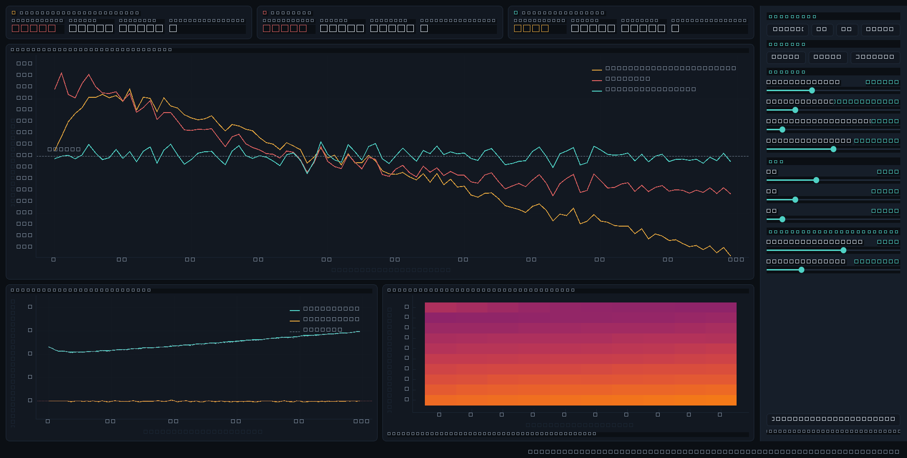
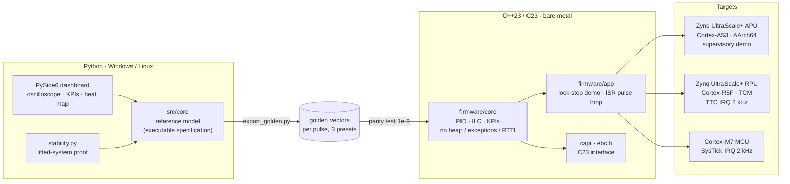

# Excimer Burst Energy Control

[](https://github.com/Nunu008/excimer-burst-control/actions/workflows/ci.yml)
[](https://github.com/Nunu008/excimer-burst-control/actions/workflows/firmware.yml)
[](https://github.com/Nunu008/excimer-burst-control/releases/latest)


[](LICENSE)

**Pulse-to-pulse energy control for a 2 kHz excimer laser burst**, from a
model-based design in Python to bare-metal firmware on AMD Xilinx Zynq UltraScale+
(Cortex-A53 and Cortex-R5F) and Cortex-M7 microcontrollers. Both sides are proven
to compute the same numbers.



> **Try it in one minute:** download the executable for Windows or Linux from the
> [latest release](https://github.com/Nunu008/excimer-burst-control/releases/latest),
> start it, press `Space`. No Python installation needed.

---

## In 30 seconds

<table>
<tr>
<td width="33%" valign="top">

### For management

**The problem.** Excimer lasers for lithography and annealing lose 20 % of their
pulse energy during each burst. Dose errors cost yield.

**The result.** A learning controller cuts the error from **21.8 % to 3.8 %** within
15 bursts and holds it. A plain PID only reaches 18.2 %.

**Why it matters.** The algorithm is developed and proven in simulation, then runs
unchanged on the production processor. This is the path that shortens bring-up time
on real machines.

</td>
<td width="33%" valign="top">

### For HR

Shown in one project, with evidence:

- **Control engineering:** model, PID, Iterative Learning Control, stability analysis
- **Embedded C/C++:** C++23 and C23, bare metal on three Arm architectures
- **Python:** desktop application with live visualisation
- **Quality:** 140 automated tests (67 Python, 73 C/C++), CI on every change
- **Process:** issues, milestones, reviewed pull requests, decision records,
  changelog, releases

</td>
<td width="33%" valign="top">

### For technical leads

- [Python ⇄ C++ parity to 1e-9](firmware/tests/test_python_parity.cpp) via golden vectors
- [A divergence in the 1.0 learning law](docs/adr/0004-robust-ilc-update-law.md),
  found by the port and fixed with a lifted-system contraction proof (ρ 1.10 → 0.69)
- [Wait-free ISR / learning split](firmware/core/include/ebc/core/realtime_controller.hpp)
  with a double-buffered table
- [Registers as types](firmware/bsp/common/include/ebc/bsp/mmio.hpp): a read-only
  register cannot be written, and the generated code is a single load or store
- Firmware images run in QEMU in CI, and the semihosting exit code is the test verdict

</td>
</tr>
</table>

---

## Contents

1. [Industrial context](#1-industrial-context)
2. [System architecture](#2-system-architecture)
3. [Control model](#3-control-model)
4. [What the demo shows](#4-what-the-demo-shows)
5. [Download, install, run](#5-download-install-run)
6. [Embedded firmware](#6-embedded-firmware)
7. [Verification](#7-verification)
8. [Design decisions worth discussing](#8-design-decisions-worth-discussing)
9. [How this project is run](#9-how-this-project-is-run)

---

## 1. Industrial context

An excimer laser (ArF/KrF, 193/248 nm) used for lithography or annealing fires
**bursts of a few hundred pulses at 2–6 kHz**. Two effects make constant-voltage
operation unusable:

1. **Gas degradation:** each discharge changes the gas chemistry, so the energy per
   pulse falls monotonically during the burst (here ≈0.4 % per pulse).
2. **Burst-start transient:** after a pause the first pulses are weaker until the
   gas state re-establishes (here a 15 % dip with a 3-pulse time constant).

The energy monitor ("Timelog") reports the pulse energy only **after** the pulse.
This adds a dead time of 1–3 pulses to every feedback loop, and that dead time is
what makes a plain PID struggle at the burst start.

**Iterative Learning Control (ILC)** exploits the fact that the disturbance is
*repetitive*: it is nearly identical in every burst. Instead of fighting it after
the fact, the controller learns a per-pulse feedforward table from burst to burst.
Feedback is left only for the non-repetitive remainder (noise, drift).

| Strategy | Idea | Behaviour |
|---|---|---|
| **HV constant** (open loop) | One charging voltage for the whole burst | Energy decays with the gas state (≈20 % droop) |
| **PID only** (feedback) | Closed loop on the energy monitor | Lags and overshoots at the burst start, limited by the dead time |
| **Hybrid ILC + PID** | Learned per-pulse feedforward + PID on the residual | Converges burst over burst; the PID share decays towards zero |

---

## 2. System architecture



**Layering rules.** `src/core` never imports Qt. `firmware/core` never touches a
register. BSPs never contain control logic. Each layer is tested on its own.

```
src/core/          Python reference model: config, plant, controllers, metrics, stability
src/ui/            PySide6 dashboard
firmware/core/     C++23 control law, header-only, templated on float/double
firmware/app/      platform-independent application: reporting, demos, ISR pulse loop
firmware/capi/     C23 interface (ebc.h) for C code bases
firmware/bsp/      startup, linker scripts, drivers: zynqmp_a53, zynqmp_r5f, cortex_m7, host
firmware/tests/    GoogleTest suite, Python parity, C API test, golden vectors
packaging/         PyInstaller spec for the Windows/Linux executables
docs/adr/          architecture decision records
```

---

## 3. Control model

### 3.1 Plant

The actuator coordinate `u` is expressed in **mJ-equivalent** units around the
operating point (the HV → energy characteristic, linearised), so the plant is

$$
E[i] = u[i] \cdot \eta(i) \cdot (1 + n[i]),
\qquad
\eta(i) = e^{-\beta i}\left(1 - d\,e^{-i/\tau}\right)
$$

with decay rate `β`, transient depth `d`, transient time constant `τ` and relative
pulse noise `n ~ N(0, σ)`. All three strategies see the **same** `n[i]` sequence, so
the comparison is paired and not limited by noise.

### 3.2 PID

$$
u_{fb}[k] = K_p e[k] + K_i \sum_{j\le k} e[j] + K_d \left(e[k]-e[k-1]\right),
\qquad e[k] = E_{target} - E_{meas}[k-L]
$$

with integral clamping (anti-windup) and an output limit. `L` is the Timelog dead
time; for the first `L` pulses the target is used as the last known energy.

### 3.3 Iterative Learning Control

The feedforward table holds one command per pulse of the burst, shown as a
**10 × 10 grid** (100 pulses). After each burst:

$$
u_{ff,k+1} = Q\!\left(u_{ff,k} + \alpha \, e_k\right),
\qquad
Q(x)[i] = \frac{1}{q}\sum_{j=-\lfloor q/2\rfloor}^{\lceil q/2\rceil - 1} x[i+j]
$$

`α` is the learning factor, and `Q` is the Q-filter (a centred moving average of
depth `q`) that keeps pulse noise out of the learned table. Because the disturbance
is repetitive, the table converges towards the inverse efficiency profile
`u_ff,∞[i] ≈ E_target / η(i)`.

The hybrid command is `u = u_ff[i] + u_fb[k]`. As the table converges, the PID term
shrinks to the noise floor, which is visible live in the actuator panel. To keep
that split meaningful, the hybrid's integrator is reset at every burst boundary: the
repetitive part belongs to the learner.

**Why `Q` filters the whole update, not just the error.** The PID acts *inside* the
burst through the dead time, so the table drives the energy through the lifted
closed loop `G` (`src/core/stability.py`), not through the plant alone.

- **Version 1.0** used `u + α·Q(e)`. Its error propagation `I − αQG` has a spectral
  radius of 1.10 (standard) to 1.26 (3-pulse latency). It diverges, invisibly over
  15 bursts, and reaches 177 % maximum deviation after 200.
- **Version 2.0** uses the robust form `Q(u + αe)`. It is a 2-norm contraction,
  `‖Q(I − αG)‖₂ ≈ 0.92 < 1`, in every preset, so it converges monotonically.
- **The price** is a bounded bias where the table cannot follow the sharp start
  transient: −2.2 % on pulse 0, and below 0.5 % on every other pulse.

The full story is in [ADR 0004](docs/adr/0004-robust-ilc-update-law.md).

### 3.4 KPIs

| KPI | Definition |
|---|---|
| Max deviation | `max |E - E_target| / E_target` in % |
| σ | Standard deviation of the energy error in mJ |
| RMS | `sqrt(mean((E - E_target)²))` in mJ |
| Settling | First pulse after which a **5-pulse moving average** of the error stays inside ±2 % |

---

## 4. What the demo shows

| Burst | Open loop | PID only | Hybrid |
|---|---|---|---|
| 0 | 21.5 % max dev | 9.2 % | 9.2 % (identical start) |
| 5 | 22.2 % | 19.6 % | 6.1 % |
| 14 | 21.8 % | 18.2 % | **3.8 %**, RMS 0.052 mJ |
| 199 | 20.5 % | 19.4 % | **3.5 %**, RMS 0.046 mJ |

These are the default preset (100 pulses, 2-pulse dead time, α = 0.6, q = 3) in the
Python model. Mean |u_fb| drops from 0.28 mJ-eq (burst 0) to 0.03 (bursts 10–14).
The PID keeps re-fighting the same transient every burst. The learned table does not
forget, and since 2.0 it does not drift either.

---

## 5. Download, install, run

### Ready-to-run executables

Every release ships a single-file executable for **Windows x64** and **Linux x64**.
CI tests each executable before publishing it: `--self-test` drives the real window
through 60 bursts and checks the control claims.

| Platform | Start |
|---|---|
| Windows | unzip, double-click `ExcimerBurstControl.exe` (unsigned: SmartScreen → *More info* → *Run anyway*) |
| Linux | `tar xzf …`, `./ExcimerBurstControl` (needs `libegl1 libxkbcommon-x11-0 libxcb-cursor0`) |

### From source

```bash
python -m venv .venv
source .venv/bin/activate          # Windows: .venv\Scripts\activate
pip install -r requirements.txt
python main.py                      # --self-test, --version
```

| Input | Action |
|---|---|
| `Space` | Play / pause the burst clock (25 bursts/s) |
| `→` | Advance one burst |
| `Ctrl+R` | Reset the simulation |
| Sliders | Target energy, gas decay, noise, Timelog latency, PID gains, α, Q-depth |
| `Export CSV` | Writes the current burst (all three modes) and the 10 × 10 matrix |

**Presets:** *Standard 2 kHz*; *Strong gas noise* (4 % pulse noise, where the PID
visibly drowns); *High latency (3 pulses)*, where the PID rings and the learned
feedforward still holds the burst. On that preset, push `Kp` above ≈1.0 to drive the
feedback into visible instability. That is the honest limit of feedback with dead
time.

---

## 6. Embedded firmware

The control law is ported to **C++23** (also built as **C++26**) with run-time code
in **C23**. It is header-only, uses no heap, exceptions or RTTI, and is templated on
the scalar type: `double` on the host for parity, `float` on the FPU-equipped targets.
Details are in [firmware/README.md](firmware/README.md).

| Target | Core | Role in the system | Timing source | Memory |
|---|---|---|---|---|
| Zynq UltraScale+ APU | Cortex-A53, AArch64 | Supervisory: three-strategy comparison, reporting | polled | PS DDR |
| Zynq UltraScale+ RPU | Cortex-R5F, ARMv7-R | Hard real time: one pulse per interrupt | TTC0 → GIC IRQ 68, 2 kHz | ATCM code, BTCM data |
| Cortex-M7 MCU | ARMv7E-M, FPv5 | The same real-time loop on a microcontroller | SysTick, 2 kHz | flash / SRAM |
| Host | x86-64 | Unit tests, Python parity, simulator CLI | — | — |

```bash
cd firmware
cmake --workflow --preset host          # 73 tests incl. Python parity
cmake --workflow --preset zynqmp-r5f    # needs the Arm GNU Toolchain on PATH
```

The pulse interrupt is O(1) and wait-free. The O(N·q) learning step runs in the
background between bursts, on a double-buffered table. If learning falls behind, the
interrupt drops the burst from learning and counts it; it never waits
([realtime_controller.hpp](firmware/core/include/ebc/core/realtime_controller.hpp)).

---

## 7. Verification

| Claim | Evidence |
|---|---|
| The control law does what the README says | `tests/` (pytest): convergence, boundedness, dead time, KPIs, presets |
| The learning law converges for every preset | `tests/test_stability.py`: `‖Q(I − αG)‖₂ < 1`, plus 200-burst runs |
| C++ computes what Python computes | `test_python_parity.cpp`: every pulse, every strategy, every KPI, 3 presets; 1e-9 (double), 5e-4 (float) |
| The firmware code is correct on its own | GoogleTest suite in double and float, `static_assert` tests, ASan/UBSan build |
| The ISR/background split is race free and never blocks | `test_realtime_controller.cpp`, `test_app.cpp` (bit-identical to lock-step; overrun accounting) |
| It builds for every target with no warnings | CI: Arm GNU Toolchain 14.2, `-Werror`, `-Wdouble-promotion`, stack usage report |
| It runs on the target instruction set | CI: Cortex-A53 on QEMU `xlnx-zcu102`, Cortex-M7 on QEMU `mps2-an500`, with the semihosting exit code as verdict; the A53 log is compared number by number with the host build |
| It can be used from C | `capi_closed_loop.c`, a plain C23 program |
| The executables work | the release workflow runs `--self-test` on the packaged Windows and Linux builds |

**Not yet verified:** a run on physical ZCU102 / MCU hardware, and the RPU boot under
QEMU (marked experimental in CI). Both are tracked as open issues. Numbers in this
README come from test runs, not from estimates.

---

## 8. Design decisions worth discussing

* **Python model as executable specification** ([ADR 0002](docs/adr/0002-python-model-as-executable-specification.md)).
  Tuning happens where it is cheap; the firmware has to reproduce it, and a test
  enforces that.
* **Paired noise.** All three strategies reuse one noise vector per burst. Otherwise
  a 1 % σ would swamp a 3 % difference and the comparison would be anecdotal.
* **Immutable configuration.** `SimulationConfig` is a frozen dataclass and
  `ControllerParams` is validated at compile time for built-in presets.
* **Units.** Working in mJ-equivalent actuator units keeps the ILC law dimensionally
  exact and the PID gains interpretable.
* **Integrator reset per burst.** A cross-burst integrator is redundant next to the
  learner and prevents the feedforward from converging to the true inverse
  efficiency. It converged 4 % low before that fix, and the test suite caught it.
* **Convergence needs an argument, not a short simulation.** See section 3.3 and
  [ADR 0004](docs/adr/0004-robust-ilc-update-law.md).
* **C++ subset for bare metal** ([ADR 0003](docs/adr/0003-cpp23-freestanding-subset.md)):
  concepts, `constexpr`, `std::expected`, `std::span`, `if consteval`, and no heap,
  exceptions or RTTI.
* **The R5F runs the loop, the A53 supervises.** The interrupt path lives in the TCM,
  so its timing is independent of DDR traffic from the application cores.

---

## 9. How this project is run

The work is tracked as it would be in a product team (see [CONTRIBUTING.md](CONTRIBUTING.md)):

- **Issues** with acceptance criteria, grouped into **milestones** per release
- **Pull requests** that close those issues, with CI required before merge
- **Conventional Commits**, a **[CHANGELOG](CHANGELOG.md)**, and semantic version tags
- **[Architecture decision records](docs/adr/README.md)** for anything a reviewer
  would otherwise ask about
- A **release workflow** that publishes tested executables and firmware images

---

## License

MIT, see [LICENSE](LICENSE).
